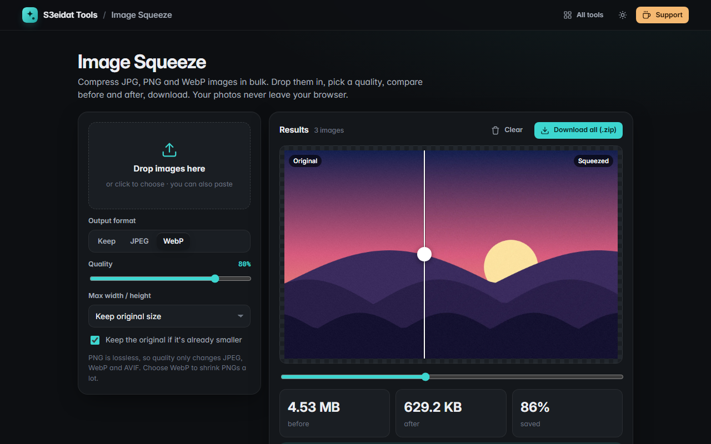

# Image Squeeze

> Compress JPG, PNG and WebP images in bulk. Free, private, and it runs entirely in your browser.

### ▶ [Open Image Squeeze](https://s3eidat.github.io/image-squeeze/)



## Features

- **Bulk**: drop, choose or paste many images at once (JPG, PNG, WebP, plus GIF/BMP/AVIF where your browser reads them)
- **Quality slider** with live re-compression
- **Output format**: keep the original format, JPEG, WebP, or AVIF (AVIF only appears if your browser can encode it)
- **Max width / height** with high-quality step-down resizing
- **Before / after compare slider** for any image (drag on the picture or use the slider)
- Original vs new size and **% saved** per file, plus totals
- **Keeps the original** when re-encoding would make it bigger (optional)
- Transparent images turn white behind the picture when saved as JPEG, and stay transparent in WebP/PNG
- Download one file or **everything as a .zip**

Note: images are re-encoded with your browser's canvas, so metadata (EXIF, GPS) is not carried over and
animated GIFs become a single frame.

## Privacy

Your images never leave your device. There is no server, no account, no analytics.
The page ships with a strict Content-Security-Policy (`connect-src 'self'`), so the browser
itself blocks any attempt to send data anywhere.

## Run it yourself

It's plain HTML, CSS and JavaScript with no build step:

```bash
git clone https://github.com/s3eidat/image-squeeze
cd image-squeeze
python -m http.server 8000
```

Then open http://localhost:8000.

## Support

If this saved you time, **[buy me a coffee ☕](https://s3eidat.github.io/coffee/)**. It keeps every tool free.

---

Part of **[S3eidat Tools](https://s3eidat.github.io/)**: 100+ free, private tools that run in your browser. MIT licensed.
